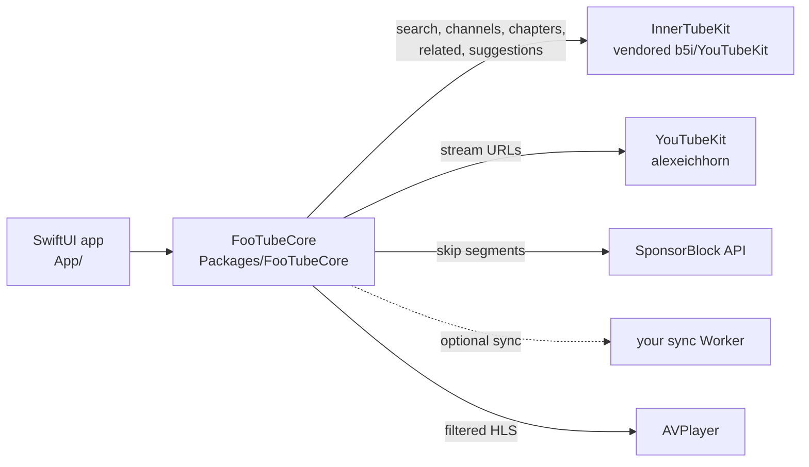

# FooTube

A native, ad-free YouTube client for Apple TV, iPhone and iPad that you build and install yourself.

FooTube resolves YouTube streams on the device itself and plays them in Apple's own video player. There is no web player, so there are no ads, and there's no Google account and no tracking. Subscriptions, history and Watch Later live on your devices; if you like, they sync between your Apple TVs, iPhones and iPads through a small server you run yourself ([Sync](#sync-optional)).

It was built for the **Apple TV HD (4th generation, A8)**, which can only decode H.264 up to 1080p. Streams are capped to that, so it runs on every Apple TV with tvOS 18 or later and every iPhone and iPad with iOS 18 or later.


| | |
|---|---|
|  |  |
|  |  |

## Features

- **Subscriptions** without an account: a feed of the latest uploads from your channels, newest first, with a sidebar to filter by channel.
- **Search** with suggestions while you type; results include matching channels.
- **Channel pages** with all uploads and a Subscribe button. Members-only videos are hidden.
- **Native player** (`AVPlayerViewController`): Siri Remote scrubbing, the info panel, original audio track, subtitles off by default.
- **SponsorBlock**: sponsor segments are skipped automatically; other segment types (intro, self-promotion, …) get a "Skip" button. Each category can be set to skip automatically, show the button, or be ignored in Settings.
- **Chapters** from the video description in the player's Chapters row, with thumbnails.
- **Scrubbing thumbnails**: pictures above the timeline while scrubbing or fast-forwarding (videos; not live streams).
- **Up next**: when a video ends, a related video (preferably from the same channel) plays after a 10-second countdown.
- **Resume** where you left off, plus **History** and **Watch Later** tabs (long-press a video for the menu).
- **Sync (optional)**: subscriptions, Watch Later, History with resume positions and SponsorBlock settings stay the same on every Apple TV of the household, through your own server on Cloudflare's free plan.
- **Settings**: SponsorBlock behavior per category, sync status, clearing History and Watch Later, version, when a sideloaded install expires, and credits.
- Interface in English and German; titles and dates in your device's language.
- Follows Apple's tvOS design: native lockups with lift and tilt, light and dark mode.
- **iPhone and iPad** (iOS 18+): the same app with touch screens (tab bar on iPhone, sidebar on iPad), Picture in Picture and AirPlay, a Chapters list in the player, a Skip button for SponsorBlock segments, and pasting the sync configuration in Settings. No Up next on iOS: a video simply ends.

## Install on your own Apple TV

You need:

- A Mac with **Xcode 26** or later (tvOS 26 SDK).
- An **Apple ID**. A free one works, but see the limits below.
- An Apple TV on the same network as the Mac.
- [Homebrew](https://brew.sh) for two command-line tools.

### 1. Get the code and tools

```sh
git clone https://github.com/framegrabber/FooTube.git
cd FooTube
brew install xcodegen xcbeautify
```

### 2. Set up signing

1. In Xcode, open **Settings → Accounts** and add your Apple ID. This creates a free "Personal Team".
2. Find your **team ID** (10 characters, e.g. `ABCDE12345`). One way to get it: create any new project in Xcode, choose your team under Signing & Capabilities, and read `DEVELOPMENT_TEAM` in its build settings. With a paid account, it's also on developer.apple.com under Account → Membership.
3. Create your local signing file (ignored by git) and fill in your team ID and a bundle ID prefix of your choice:

   ```sh
   cp Config/Signing.local.xcconfig.example Config/Signing.local.xcconfig
   open -e Config/Signing.local.xcconfig
   ```

### 3. Pair the Apple TV with Xcode

1. On the Apple TV, open **Settings → Remotes and Devices → Remote App and Devices** and leave it open.
2. In Xcode, open **Window → Devices and Simulators**. The Apple TV appears under "Discovered"; click **Pair** and enter the code shown on the TV.

tvOS has no Developer Mode switch: once paired, the Apple TV shows a "Developer" section in Settings.

### 4. Build, install and launch

```sh
scripts/run-device.sh
```

The script picks the first paired Apple TV; set `FOOTUBE_DEVICE="<name or identifier>"` to choose another. It builds, installs and launches FooTube. Xcode creates the provisioning profile automatically the first time.

Prefer Xcode? Run `xcodegen generate && open FooTube.xcodeproj`, choose your Apple TV as the run destination, and press Run.

### Limits of a free Apple ID

- The app **stops launching after 7 days**. Run `scripts/run-device.sh` again to renew it; your subscriptions and history stay.
- At most 3 sideloaded apps per device, and a limited number of new app IDs per week.
- Per-user data for several Apple TV users (the "User Management" capability) and iCloud sync need the paid Apple Developer Program.

With the paid program ($99/year), installs last a year.

## Install on your iPhone or iPad

Same Mac, tools and signing file as for the Apple TV (steps 1 and 2 above); the same bundle ID covers both.

1. Connect the iPhone or iPad to the Mac with a cable once and trust the Mac. In Xcode, **Window → Devices and Simulators** shows it; after that it can also install over the network.
2. On the device, turn on **Settings → Privacy & Security → Developer Mode** (it appears after the device has been connected to Xcode) and restart when asked.
3. Build, install and launch:

   ```sh
   scripts/run-ios-device.sh
   ```

   The script picks the first paired iPhone or iPad; `FOOTUBE_DEVICE="<name or identifier>"` chooses another.
4. The first launch fails until you trust your developer profile: **Settings → General → VPN & Device Management** → your Apple ID → **Trust**. Then launch FooTube from the home screen.

The same limits apply as on the Apple TV: a free Apple ID's install stops launching after 7 days (run the script again; your data stays) and counts as one of the 3 sideloaded apps on that device. Sync can be set up by the script (as for the Apple TV) or by pasting URL and token in the app's Settings.

## Try it in the Simulator

No Apple ID or team is needed:

```sh
scripts/run-sim.sh          # "Apple TV"
scripts/run-sim.sh --ios    # "iPhone 17"
scripts/run-sim.sh --ipad   # "iPad Pro 11-inch (M5)"
```

`FOOTUBE_SIM="<name>"` picks another Simulator of that platform. The Simulator decodes video with your Mac's hardware, so it says nothing about playback performance on a real Apple TV HD. The iPhone Simulator doesn't offer Picture in Picture; the iPad Simulator does.

Debug launch arguments (Simulator or `run-device.sh`/`run-ios-device.sh`, after the `--ios`/`--ipad` flag): `-play <video ID or URL>`, `-search <query>`, `-channel <channel ID>`, `-subscribe <channel ID,channel ID>`.

## Sync (optional)

Subscriptions, Watch Later, History (with resume positions) and SponsorBlock settings can be the same on every Apple TV, iPhone and iPad of your household. They go only to a small server you deploy yourself on Cloudflare's free plan, from the FooTubeSyncBackend repository: its README covers deploying it and creating the token. Without it, FooTube sends nothing anywhere new.

Connect each Apple TV once (iPhone/iPad: the same with `scripts/run-ios-device.sh`). Put the Worker's URL and the sync token in `~/.config/footube/sync.env`, readable only by you:

```sh
mkdir -p ~/.config/footube
touch ~/.config/footube/sync.env && chmod 600 ~/.config/footube/sync.env
open -e ~/.config/footube/sync.env   # add the two lines below, then save
```

```
FOOTUBE_SYNC_URL=https://footube-sync.<subdomain>.workers.dev
FOOTUBE_SYNC_TOKEN=<token>
```

Then run `scripts/run-device.sh` (or `run-sim.sh`, `run-ios-device.sh`); they read the file on every run (another file via `FOOTUBE_SYNC_ENV`). The file is read as data, not run as shell code: only those two lines count (values optionally in quotes, nothing expanded), and the scripts refuse a file that isn't yours or that group or others can write to. Typing the token on the command line instead would leave it in your shell history and in the environment of every tool the script runs. The script copies URL and token as a small file into the installed app's container; at launch the app keeps the URL, stores the token in its Keychain (on this device only, not in backups) and deletes the file. The token never goes into the repository, the app bundle, the build settings or the launch command. If the device refuses to launch FooTube, that file waits in the app's container until FooTube opens. Later runs without the file keep the configuration; `scripts/run-device.sh -syncReset YES` turns sync off (local data stays).

FooTube syncs when it opens, every 5 minutes while it's open, a few seconds after a change, when the player closes and when it goes to the background. **Settings → Sync** shows the state ("Synced 2 minutes ago", "Offline, will retry", "Token rejected") and offers **Sync Now**; a missing network never blocks browsing or playback. A removal (unsubscribe, Watch Later) isn't undone by another device, even one that was off for months.

**On iPhone and iPad** you can also connect in the app: **Settings → Server**, paste the Worker's URL and the **sync token** (not the inbox token), tap **Connect**. FooTube checks both with the Worker before saving them; a wrong token is rejected with a message, and once saved the token stays in the Keychain and isn't shown again. **Change Server…** and **Turn Off Sync** are below.

For development against a local Worker: `npm run dev` in FooTubeSyncBackend, then `FOOTUBE_SYNC_URL=http://localhost:8787 FOOTUBE_SYNC_TOKEN=<token from its .dev.vars> scripts/run-sim.sh` (a throwaway local token, so passing it inline is fine; or a second file via `FOOTUBE_SYNC_ENV`).

### Adding videos from anywhere

With sync on, videos can go into Watch Later from places FooTube doesn't run. They wait in your Worker's inbox and show up in Watch Later on every device at its next sync (on iPhone/iPad and Apple TV, **Refresh** in Watch Later syncs right away). All of these use the Worker's **inbox token** (FooTubeSyncBackend README, step 3), which can only add videos. Never put the household sync token into a bookmark or a Shortcut.

**Bookmark "→ FooTube" (Mac, iPhone, iPad):** generate it as the FooTubeSyncBackend README describes (step 7) and save it as a bookmark in Safari or Chrome. On a YouTube video page, choosing the bookmark adds the video. In Safari on iPhone or iPad, bookmarks synced from the Mac through iCloud work as they are; to create one on the device itself, bookmark any page (Share → Add Bookmark), then open Bookmarks → Edit → the bookmark, and replace its address with the copied `javascript:` line. To use it, open a video on youtube.com in Safari, tap the address bar and choose the bookmark from the list (or open Bookmarks and tap it).

**Shortcut "Add to FooTube" (iPhone, iPad):** adds a video from the share sheet of the YouTube app, Safari or any app that shares a YouTube link, even on a device without FooTube. Build it once in the Shortcuts app:

1. Tap **+** to create a shortcut and rename it to `Add to FooTube` (tap its name at the top → Rename).
2. Tap **ⓘ** (Details) and turn on **Show in Share Sheet**. Back in the editor, the top block reads "Receive … input from Share Sheet": tap the input types and keep only **URLs**, **Safari web pages** and **Text**. Optionally set "If there's no input" to **Get Clipboard**, so running the shortcut by itself takes a copied link.
3. Add the action **Match Text**. Pattern: `(?:v=|youtu\.be/|shorts/|live/|embed/)([A-Za-z0-9_-]{11})`, text: **Shortcut Input**.
4. Add **Get Group from Matched Text** and set it to "Get **Group At Index** 1 in **Matches**".
5. Add **If**: "If **Group** **does not have any value**". Inside the If (before Otherwise), add **Show Notification** with the text `Not a YouTube video` and **Stop This Shortcut**. Leave Otherwise empty; the next actions go after **End If**.
6. Optional, for a title instead of the bare video ID in Watch Later: add **Get Contents of URL** with the URL `https://www.youtube.com/oembed?format=json&url=https://youtu.be/` followed by the **Group** variable, then **Get Dictionary Value**: "Get **Value** for `title` in **Contents of URL**".
7. Add **Get Contents of URL** with the URL `https://footube-sync.<subdomain>.workers.dev/v1/inbox` (your Worker). Tap the arrow (Show More) and set:
   - **Method:** POST
   - **Headers:** add a header with key `Authorization` and value `Bearer <inbox token>` (the word Bearer, a space, the inbox token).
   - **Request Body:** JSON. Add a **Text** field with key `videoID` and value **Group**; with step 6, add a second Text field with key `title` and value **Dictionary Value**.
8. Add **If**: "If **Contents of URL** **has any value**" (the Worker answers success with an empty body and errors with a JSON message): inside, **Show Alert** with **Contents of URL**; under Otherwise, **Show Notification** with `Added to FooTube`.

To use it, tap **Share** on a video in the YouTube app (or on a youtube.com page in Safari) and choose **Add to FooTube**; it may be under **More** or "Edit Actions" the first time. The request the shortcut sends, as `curl`:

```sh
curl -X POST https://footube-sync.<subdomain>.workers.dev/v1/inbox \
  -H "Authorization: Bearer <inbox token>" -H "Content-Type: application/json" \
  -d '{"videoID":"aqz-KE-bpKQ","title":"Big Buck Bunny"}'
```

**`footube://` links (iPhone, iPad):** `footube://play?v=<video ID or YouTube URL>` opens FooTube and plays the video; `footube://watch-later?v=<video ID or YouTube URL>` (optionally `&title=<title>`) adds it to Watch Later on that device, which syncs it like any other change. In a shortcut: **URL Encode** the shared link, then **Open URLs** with `footube://watch-later?v=` followed by the encoded text. These need FooTube installed on the device; the inbox Shortcut above doesn't.

## Using it

- **Tabs:** Subscriptions, Search, Watch Later, History, Settings (on iPad, the tab bar can turn into a sidebar).
- **Long press** a video: open its channel, add to or remove from Watch Later. On iPhone and iPad, swipe left in Watch Later and History to remove a video, and pull down to refresh.
- **Menu button** (Apple TV): goes back one level; on a tab's main screen it moves to the tab bar; on the tab bar it leaves the app (tvOS convention). Going up to the tab bar and back down returns a tab to its main screen.
- **Player on iPhone and iPad:** the system player full screen; **Chapters** opens the chapter list, a **Skip** button appears for SponsorBlock segments set to "Show Skip Button", Picture in Picture starts from its button or when you leave the app while a video plays, AirPlay from its button. Close the player with ✕ or a swipe down.
- **Appearance** follows the device setting (Apple TV: Settings → General → Appearance).

## How it works



- **Streams:** [YouTubeKit](https://github.com/alexeichhorn/YouTubeKit) gets the HLS master playlist. FooTube rewrites it to keep only H.264 ≤ 1080p video and the original audio track, then hands it to `AVPlayer`.
- **Catalog:** search, channel uploads, chapters, related videos and suggestions use YouTube's internal InnerTube API through a vendored, renamed copy of [b5i/YouTubeKit](https://github.com/b5i/YouTubeKit) (`Packages/InnerTubeKit`; changes are listed in its `VENDORED.md`).
- **State:** subscriptions, feed cache, history, Watch Later and settings are stored in `UserDefaults` on the device; tvOS may delete files, but not these. With sync on, subscriptions, Watch Later, history and SponsorBlock settings are also merged with your sync Worker's copy (one JSON document each; removals are kept as markers for 90 days so other devices don't bring them back).

Background on why it's built this way: [docs/research.md](docs/research.md).

## Development

| | |
|---|---|
| All checks (format, secrets, build with warnings as errors, tests, dependency scan) | `scripts/check.sh task` |
| Core unit tests | `swift test --package-path Packages/FooTubeCore` |
| Tests against real YouTube | `FOOTUBE_NETWORK_TESTS=1 swift test --package-path Packages/FooTubeCore` |
| Remote-driven UI tests (Apple TV) | `xcodebuild test -project FooTube.xcodeproj -scheme FooTube -destination 'platform=tvOS Simulator,name=Apple TV'` |
| Touch UI test (iPhone; iPad likewise) | `xcodebuild test -project FooTube.xcodeproj -scheme FooTube -destination 'platform=iOS Simulator,name=iPhone 17'` |

`scripts/check.sh` additionally needs `swiftformat`, `gitleaks`, `osv-scanner` and Node.js. The project was built with AI coding agents: [SPEC.md](SPEC.md) describes what it does, [CONSTRAINTS.md](CONSTRAINTS.md) the rules every change has to pass, [AGENTS.md](AGENTS.md) the working guide, and `tasks/` the plan and test results.

## Caveats

- FooTube is a personal project, not affiliated with or endorsed by YouTube or Google. Accessing YouTube this way is against YouTube's Terms of Service. Use it for yourself, at your own risk.
- YouTube changes its internal API regularly. When it does, playback or search can break until the libraries catch up.
- Made-for-kids videos currently don't play, and relative upload dates for sorting the feed are only parsed in English and German.

## Credits and license

- [b5i/YouTubeKit](https://github.com/b5i/YouTubeKit) (MIT), vendored as InnerTubeKit
- [alexeichhorn/YouTubeKit](https://github.com/alexeichhorn/YouTubeKit) (MIT)
- [SponsorBlock](https://sponsor.ajay.app): segment data by the SponsorBlock community, licensed [CC BY-NC-SA 4.0](https://creativecommons.org/licenses/by-nc-sa/4.0/)

FooTube is released under the [MIT License](LICENSE).
