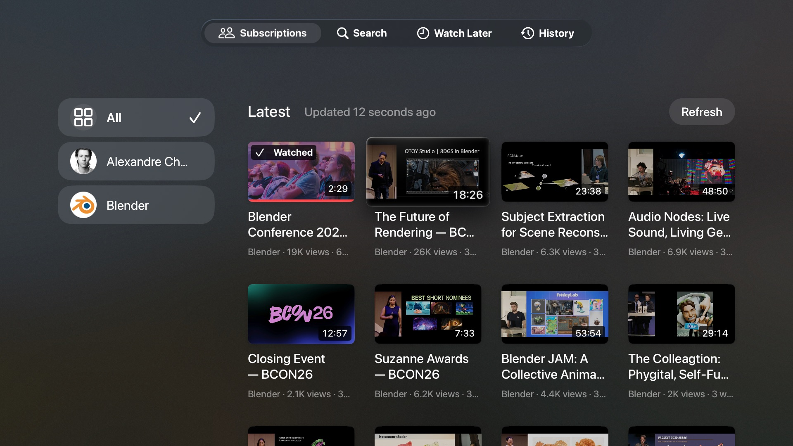
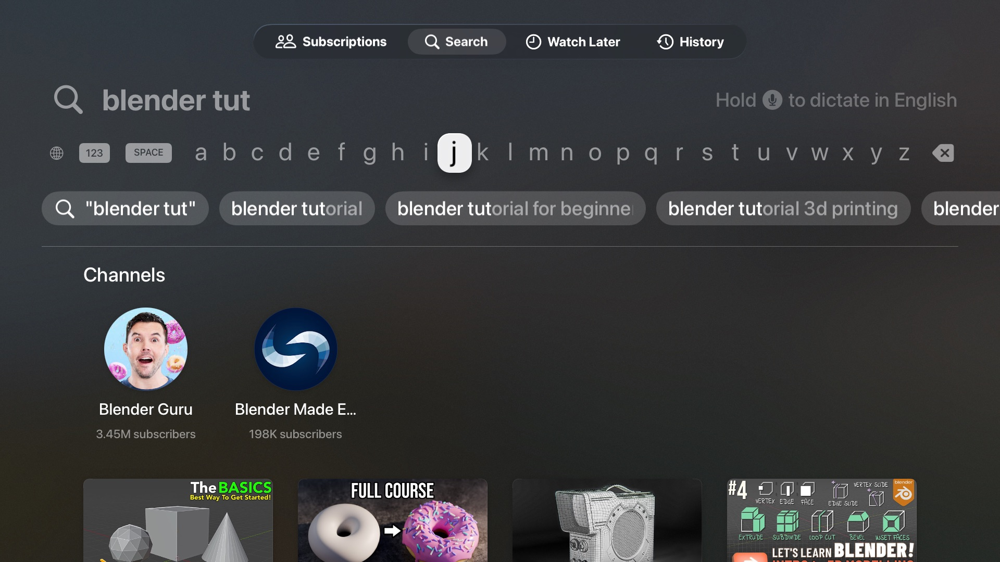
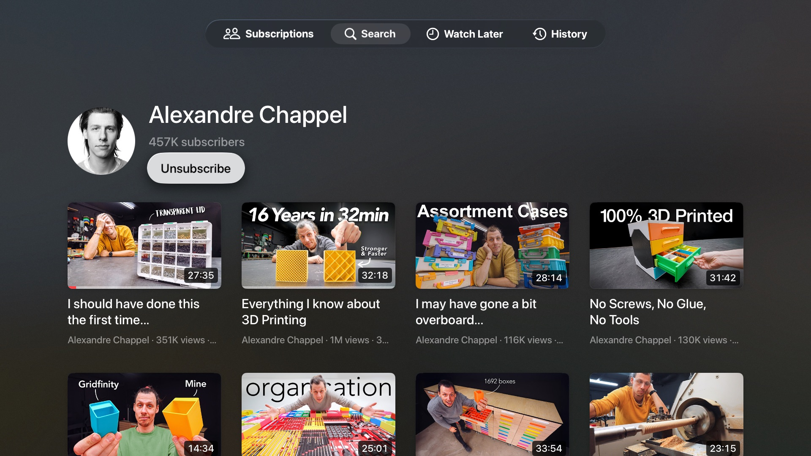
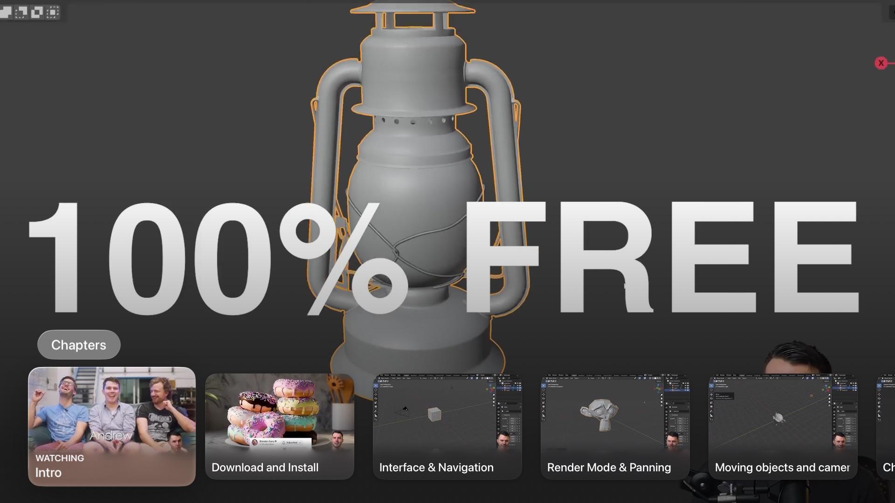
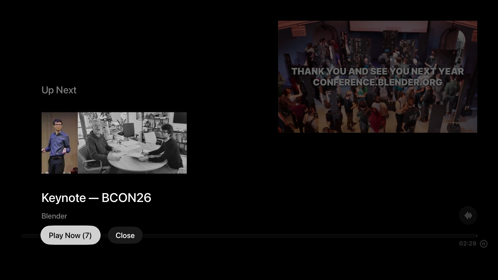
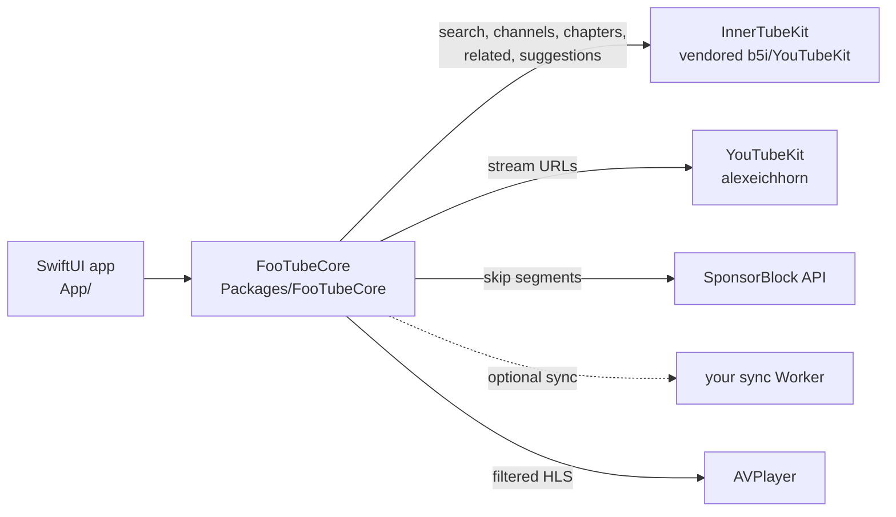

# FooTube

A native, ad-free YouTube client for Apple TV that you build and install yourself.

FooTube resolves YouTube streams on the Apple TV itself and plays them in Apple's own video player. There is no web player, so there are no ads, and there's no Google account and no tracking. Subscriptions, history and Watch Later live on your Apple TV; if you like, they sync between your Apple TVs through a small server you run yourself ([Sync](#sync-optional)).

It was built for the **Apple TV HD (4th generation, A8)**, which can only decode H.264 up to 1080p. Streams are capped to that, so it runs on every Apple TV with tvOS 18 or later.



| | |
|---|---|
|  |  |
|  |  |

## Features

- **Subscriptions** without an account: a feed of the latest uploads from your channels, newest first, with a sidebar to filter by channel.
- **Search** with suggestions while you type; results include matching channels.
- **Channel pages** with all uploads and a Subscribe button. Members-only videos are hidden.
- **Native player** (`AVPlayerViewController`): Siri Remote scrubbing, the info panel, original audio track, subtitles off by default.
- **SponsorBlock**: sponsor segments are skipped automatically; other segment types (intro, self-promotion, …) get a "Skip" button. Each category can be set to skip automatically, show the button, or be ignored in Settings.
- **Chapters** from the video description in the player's Chapters row, with thumbnails.
- **Scrubbing thumbnails**: pictures above the timeline while scrubbing or fast-forwarding (videos; not live streams).
- **Up next**: when a video ends, a related video (preferably from the same channel) plays after a 10-second countdown.
- **Resume** where you left off, plus **History** and **Watch Later** tabs (long-press a video for the menu).
- **Sync (optional)**: subscriptions, Watch Later, History with resume positions and SponsorBlock settings stay the same on every Apple TV of the household, through your own server on Cloudflare's free plan.
- **Settings**: SponsorBlock behavior per category, sync status, clearing History and Watch Later, version, when a sideloaded install expires, and credits.
- Interface in English and German; titles and dates in your Apple TV's language.
- Follows Apple's tvOS design: native lockups with lift and tilt, light and dark mode.

## Install on your own Apple TV

You need:

- A Mac with **Xcode 26** or later (tvOS 26 SDK).
- An **Apple ID**. A free one works, but see the limits below.
- An Apple TV on the same network as the Mac.
- [Homebrew](https://brew.sh) for two command-line tools.

### 1. Get the code and tools

```sh
git clone https://github.com/framegrabber/FooTube.git
cd FooTube
brew install xcodegen xcbeautify
```

### 2. Set up signing

1. In Xcode, open **Settings → Accounts** and add your Apple ID. This creates a free "Personal Team".
2. Find your **team ID** (10 characters, e.g. `ABCDE12345`). One way to get it: create any new project in Xcode, choose your team under Signing & Capabilities, and read `DEVELOPMENT_TEAM` in its build settings. With a paid account, it's also on developer.apple.com under Account → Membership.
3. Create your local signing file (ignored by git) and fill in your team ID and a bundle ID prefix of your choice:

   ```sh
   cp Config/Signing.local.xcconfig.example Config/Signing.local.xcconfig
   open -e Config/Signing.local.xcconfig
   ```

### 3. Pair the Apple TV with Xcode

1. On the Apple TV, open **Settings → Remotes and Devices → Remote App and Devices** and leave it open.
2. In Xcode, open **Window → Devices and Simulators**. The Apple TV appears under "Discovered"; click **Pair** and enter the code shown on the TV.

tvOS has no Developer Mode switch: once paired, the Apple TV shows a "Developer" section in Settings.

### 4. Build, install and launch

```sh
scripts/run-device.sh
```

The script picks the first paired Apple TV; set `FOOTUBE_DEVICE="<name or identifier>"` to choose another. It builds, installs and launches FooTube. Xcode creates the provisioning profile automatically the first time.

Prefer Xcode? Run `xcodegen generate && open FooTube.xcodeproj`, choose your Apple TV as the run destination, and press Run.

### Limits of a free Apple ID

- The app **stops launching after 7 days**. Run `scripts/run-device.sh` again to renew it; your subscriptions and history stay.
- At most 3 sideloaded apps per device, and a limited number of new app IDs per week.
- Per-user data for several Apple TV users (the "User Management" capability) and iCloud sync need the paid Apple Developer Program.

With the paid program ($99/year), installs last a year.

## Try it in the Simulator

No Apple ID or team is needed:

```sh
scripts/run-sim.sh
```

The script uses the "Apple TV" simulator. The Simulator decodes video with your Mac's hardware, so it says nothing about playback performance on a real Apple TV HD.

Debug launch arguments (Simulator or `run-device.sh`): `-play <video ID or URL>`, `-search <query>`, `-channel <channel ID>`, `-subscribe <channel ID,channel ID>`.

## Sync (optional)

Subscriptions, Watch Later, History (with resume positions) and SponsorBlock settings can be the same on every Apple TV of your household. They go only to a small server you deploy yourself on Cloudflare's free plan, from the FooTubeSyncBackend repository: its README covers deploying it and creating the token. Without it, FooTube sends nothing anywhere new.

Connect each Apple TV once:

```sh
FOOTUBE_SYNC_URL=https://footube-sync.<subdomain>.workers.dev FOOTUBE_SYNC_TOKEN=<token> scripts/run-device.sh
```

Or put both variables in `~/.config/footube/sync.env` (shell syntax; another file via `FOOTUBE_SYNC_ENV`), which `run-device.sh` and `run-sim.sh` read on every run. The script copies them as a small file into the installed app's container; at launch the app keeps the URL, stores the token in its Keychain and deletes the file. The token never goes into the repository, the app bundle, the build settings or the launch command. Later runs without the variables keep the configuration; `scripts/run-device.sh -syncReset YES` turns sync off (local data stays).

FooTube syncs when it opens, every 5 minutes while it's open, a few seconds after a change, when the player closes and when it goes to the background. **Settings → Sync** shows the state ("Synced 2 minutes ago", "Offline, will retry", "Token rejected") and offers **Sync Now**; a missing network never blocks browsing or playback. A removal (unsubscribe, Watch Later) isn't undone by another Apple TV, even one that was off for months.

For development against a local Worker: `npm run dev` in FooTubeSyncBackend, then `FOOTUBE_SYNC_URL=http://localhost:8787 FOOTUBE_SYNC_TOKEN=<token from its .dev.vars> scripts/run-sim.sh`.

## Using it

- **Tabs:** Subscriptions, Search, Watch Later, History, Settings.
- **Long press** a video: open its channel, add to or remove from Watch Later.
- **Menu button:** goes back one level; on a tab's main screen it moves to the tab bar; on the tab bar it leaves the app (tvOS convention). Going up to the tab bar and back down returns a tab to its main screen.
- **Appearance** follows the Apple TV setting: Settings → General → Appearance.

## How it works



- **Streams:** [YouTubeKit](https://github.com/alexeichhorn/YouTubeKit) gets the HLS master playlist. FooTube rewrites it to keep only H.264 ≤ 1080p video and the original audio track, then hands it to `AVPlayer`.
- **Catalog:** search, channel uploads, chapters, related videos and suggestions use YouTube's internal InnerTube API through a vendored, renamed copy of [b5i/YouTubeKit](https://github.com/b5i/YouTubeKit) (`Packages/InnerTubeKit`; changes are listed in its `VENDORED.md`).
- **State:** subscriptions, feed cache, history, Watch Later and settings are stored in `UserDefaults` on the device; tvOS may delete files, but not these. With sync on, subscriptions, Watch Later, history and SponsorBlock settings are also merged with your sync Worker's copy (one JSON document each; removals are kept as markers for 90 days so other Apple TVs don't bring them back).

Background on why it's built this way: [docs/research.md](docs/research.md).

## Development

| | |
|---|---|
| All checks (format, secrets, build with warnings as errors, tests, dependency scan) | `scripts/check.sh task` |
| Core unit tests | `swift test --package-path Packages/FooTubeCore` |
| Tests against real YouTube | `FOOTUBE_NETWORK_TESTS=1 swift test --package-path Packages/FooTubeCore` |
| Remote-driven UI tests | `xcodebuild test -project FooTube.xcodeproj -scheme FooTube -destination 'platform=tvOS Simulator,name=Apple TV'` |

`scripts/check.sh` additionally needs `swiftformat`, `gitleaks`, `osv-scanner` and Node.js. The project was built with AI coding agents: [SPEC.md](SPEC.md) describes what it does, [CONSTRAINTS.md](CONSTRAINTS.md) the rules every change has to pass, [AGENTS.md](AGENTS.md) the working guide, and `tasks/` the plan and test results.

## Caveats

- FooTube is a personal project, not affiliated with or endorsed by YouTube or Google. Accessing YouTube this way is against YouTube's Terms of Service. Use it for yourself, at your own risk.
- YouTube changes its internal API regularly. When it does, playback or search can break until the libraries catch up.
- Made-for-kids videos currently don't play, and relative upload dates for sorting the feed are only parsed in English and German.

## Credits and license

- [b5i/YouTubeKit](https://github.com/b5i/YouTubeKit) (MIT), vendored as InnerTubeKit
- [alexeichhorn/YouTubeKit](https://github.com/alexeichhorn/YouTubeKit) (MIT)
- [SponsorBlock](https://sponsor.ajay.app): segment data by the SponsorBlock community, licensed [CC BY-NC-SA 4.0](https://creativecommons.org/licenses/by-nc-sa/4.0/)

FooTube is released under the [MIT License](LICENSE).
